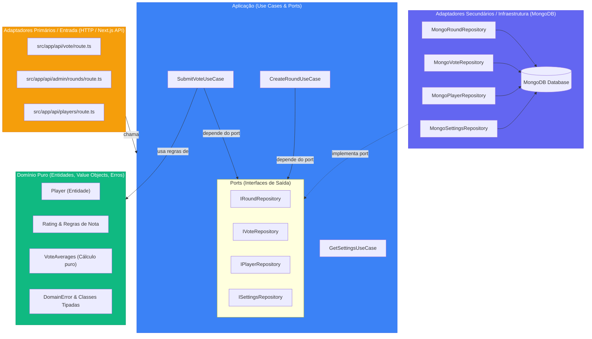
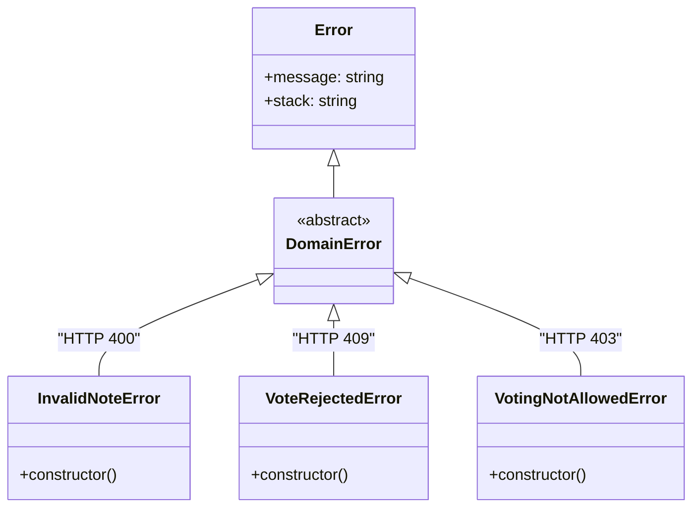
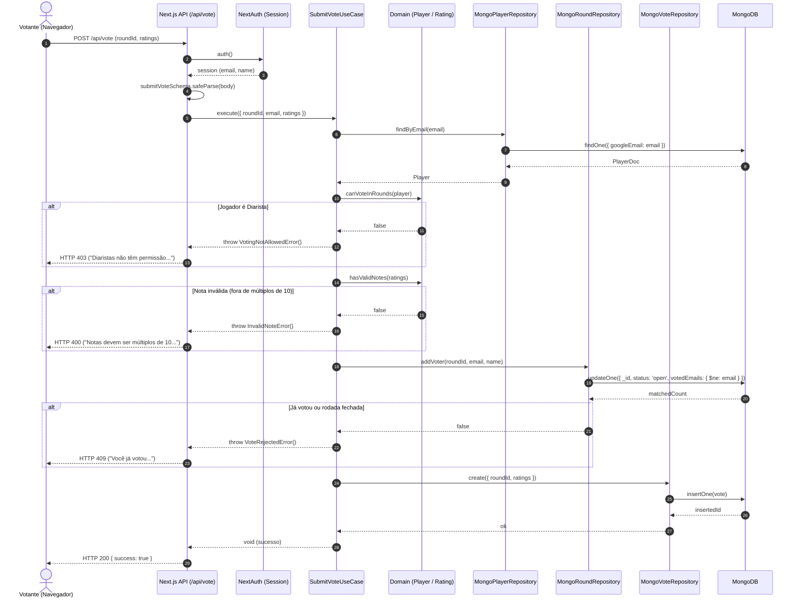

# Arquitetura e Padrões de Design — Perronhas Rebirth

> Documento técnico que detalha a arquitetura do sistema, os padrões de design adotados e as fronteiras entre camadas, servindo de guia para desenvolvedores e agentes de IA (Claude Code e Gemini).

---

## 1. Visão Geral da Arquitetura Hexagonal (Ports & Adapters)

O sistema adota os princípios de **Clean Architecture**, **Domain-Driven Design (DDD)** e **Arquitetura Hexagonal** no backend (`src/core/` e `src/app/api/`).

### A Regra Fundamental de Dependência
As dependências de código-fonte apontam estritamente **de fora para dentro**:
- **Domínio (`core/domain`)**: O coração da aplicação. Não importa nada de Next.js, MongoDB, React ou bibliotecas externas.
- **Aplicação (`core/use-cases` e `core/ports`)**: Orquestra os fluxos de negócio. Conhece apenas o Domínio.
- **Infraestrutura (`core/infrastructure`)**: Implementa as interfaces (Ports) usando MongoDB.
- **Apresentação / Adaptadores de Entrada (`src/app/api/` e `src/app/`)**: Rotas HTTP do Next.js e UI React.



---

## 2. Padrões de Design Aplicados (Design Patterns)

### 2.1. Inversão de Dependência (Dependency Inversion Principle - DIP)
Em vez de os casos de uso instanciarem conexões de banco de dados diretamente, eles declaram o que precisam através de **Interfaces (Ports)**:

```typescript
// src/core/use-cases/SubmitVoteUseCase.ts
export class SubmitVoteUseCase {
  constructor(
    private roundRepo: IRoundRepository,   // Port
    private voteRepo: IVoteRepository,     // Port
    private playerRepo: IPlayerRepository  // Port
  ) {}
  
  async execute(data: SubmitVoteDTO): Promise<void> {
    // Orquestração sem saber que o banco é MongoDB
  }
}
```

### 2.2. Repository Pattern (Port / Adapter)
Separa a lógica de acesso a dados da lógica de negócios.
- **Port:** `src/core/ports/IPlayerRepository.ts`
- **Adapter Concreto:** `src/core/infrastructure/MongoPlayerRepository.ts`

### 2.3. Typed Domain Errors (Tratamento Limpo de Exceções)
Erros de negócio herdam de `DomainError`. As rotas HTTP mapeiam o status através do operador `instanceof`, eliminando o antipadrão de verificar texto de mensagem (`error.message.includes(...)`):



### 2.4. Pure Domain Services / Functions
Lógicas matemáticas e de cálculo estatístico (como a média ponderada e arredondamento das notas dos votos) são funções puras em `src/core/domain/VoteAverages.ts`. Elas não realizam I/O, são imutáveis e possuem cobertura de testes de 100%.

---

## 3. Diagrama de Sequência de um Fluxo Típico (Votação)

O diagrama abaixo ilustra como uma requisição HTTP viaja pelas camadas sem violar os limites arquiteturais:



---

## 4. Padrões de Design no Frontend (React / Client Layer)

Para os componentes de UI de alta complexidade (como o sorteador `TeamDrawer.tsx`), a arquitetura adota:

1. **Custom Hooks para Lógica de Estado (Separation of Concerns):**
   - Isolação de drag-and-drop (`useTeamDragAndDrop`).
   - Isolação de cálculo de equilíbrio e médias de times (`useTeamBalance`).
2. **Compound Components & Decomposição:**
   - Em vez de um único arquivo de 1.100 linhas, a UI se divide em componentes com responsabilidade única:
     - `PlayerPool`: seleção e filtragem de jogadores.
     - `TeamCard`: visualização de um time, suas notas e lista de atletas.
     - `BalanceBar`: exibição comparativa do equilíbrio dos times.
     - `WhatsAppExportDialog`: diálogo e formatação da mensagem para o WhatsApp.
3. **Data Theme Provider via CSS Variables:**
   - Alternância de temas claro/escuro via atributo `data-theme` no HTML root, consumindo tokens em `globals.css`.

---

## 5. Mapeamento das 3 Skills no Repositório

```text
sorteador-times-app/
├── .agents/skills/
│   ├── clean-ddd-hexagonal/  ---> Regras do backend (core, domain, ports, use-cases)
│   ├── clean-code/           ---> Regras de legibilidade, SRP, nomes e testes em todo o repo
│   └── refactoring-patterns/ ---> Técnicas de divisão de arquivos grandes e redução de complexidade
```
